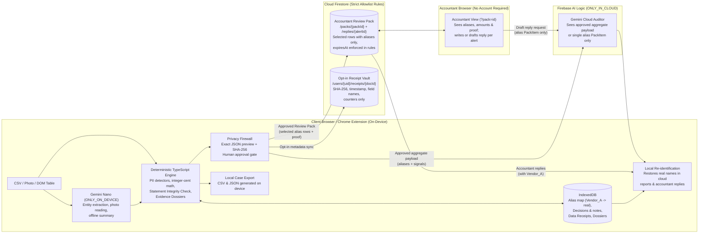

# Zenith Ledger

**The accountant gets the proof, not your statement.**

**Live demo:** https://zenith-ledger-app.web.app (desktop Chrome for Gemini Nano; any browser runs strict mode and the Accountant View)

When a small business or freelancer spots a questionable charge or a balance gap in a bank export, the usual options are either sending the entire raw bank statement (with every card number, client name, IBAN, and unrelated transaction) to an accountant or a cloud LLM, or doing manual spreadsheet reconciliation.

Zenith Ledger turns a raw statement (CSV, statement/receipt photo, or an open online-banking web table via the Chrome extension) into **verifiable audit evidence on your device**:

1. **Deterministic Statement Integrity Check:** validates running balances row-by-row, flags unusual chronological date gaps, catches exact duplicate rows from export errors, checks whether the statement covers the declared period, and detects missing pages (balance jumps across page boundaries) in multi-page photo reads — each with its own readable proof (`expected 1,204.10, statement says 1,104.10, gap between rows 41–42` for balances; `no transactions for 21 days between 2025-07-15 (row 23) and 2025-08-05 (row 24)` for dates). A repeated line whose balance did not move is flagged as an export error, and the matching double-charge alert is downgraded to match.
2. **Evidence Dossier per Alert:** every anomaly and integrity alert opens a local dossier showing its exact origin rows (line and page numbers), the applied rule and its active **Firebase Remote Config** threshold, the computed metrics, Gemini Nano photo read provenance (including whether the user edited the row in **Check what was read**), and a decision (`Explained`, `Ask my accountant`, or `Ignore`) with a note persisted in **IndexedDB**.
3. **Accountant Review Pack:** mark only the alerts you want your accountant to inspect as `Ask my accountant`. Zenith packages **only those origin rows**, pseudonymized with consistent aliases (`Vendor_A`, `Person_1`), plus the computed proof and your question. You inspect the exact JSON and its SHA-256 in the **Privacy Firewall**, then share an **expiring capability link** backed by **Cloud Firestore** security rules.
4. **No-Account Accountant View & Local Re-identification:** your accountant opens the link in the same web app (`?pack=<packId>`) without creating an account, sees only aliases, amounts, and computed evidence, can ask **Gemini in the cloud (`ONLY_IN_CLOUD`)** for a draft accounting reply (which also sees only aliases), and submits their response. Your browser fetches the response and restores the real names locally from IndexedDB. **Real names never travel.**
5. **On-Device Accountant Export:** export the full case (alerts, computed evidence, origin rows, user decisions, and accountant replies) as CSV or JSON generated entirely on your laptop.

## Architecture: What Runs On-Device, In the Cloud, and In Firestore



| Boundary | Runs / Lives | Sees | Never Sees |
| --- | --- | --- | --- |
| **Deterministic Core (`src/core/`)** | Browser / Extension | Raw rows (CSV, photo review, or DOM table) | Network |
| **Gemini Nano (`ONLY_ON_DEVICE`)** | Desktop Chrome (on device) | Raw descriptions in batches of 20, statement & receipt photos, anonymized offline overview | Cloud fallback (`PREFER_ON_DEVICE` is banned by `src/ai/policy.test.ts`) |
| **IndexedDB (`src/store/`)** | Browser local storage | Alias map (`Vendor_A -> real name`), Evidence Dossiers, alert decisions & notes, Data Receipts | Remote servers |
| **Gemini Cloud (`ONLY_IN_CLOUD`)** | Firebase AI Logic | User-approved aggregate audit payload OR a single pseudonymized `PackItem` for drafting an accountant reply | Raw descriptions, real names, cards, IBANs, emails, phones, unselected rows |
| **Cloud Firestore (`firestore.rules`)** | Firebase Cloud Firestore | **Accountant Review Pack** (`/packs/{packId}`: only the rows of alerts marked `Ask my accountant`, with `Vendor_A` aliases, computed proof, and `expiresAt`) and **Receipt Vault** (`/users/{uid}/receipts/{docId}`: send time, SHA-256, field names, counters) | Real merchant or person names, raw descriptions, full statement rows, or expired packs |

## Platforms

- **Web application (`src/`):** single-page app hosted on Firebase Hosting (https://zenith-ledger-app.web.app). Includes the client audit workspace, Evidence Dossiers, Privacy Firewall, Receipt Vault, local CSV/JSON case exporter, and the no-account **Accountant View** (`?pack=<packId>`).
- **Chrome Extension, Manifest V3 (`extension/`):** **Audit with Zenith** side panel that extracts the transaction table directly from the DOM of the open web page (for example, an online banking activity page) or accepts a dropped CSV statement, and runs the exact same `src/core` and `src/ai` pipeline on your device.

## Firebase products used

| Firebase product | What it does in Zenith Ledger |
| --- | --- |
| **Firebase AI Logic (`firebase/ai`)** | Drives both inference layers through the Gemini Developer API: `InferenceMode.ONLY_ON_DEVICE` for local entity extraction, photo reading and offline summaries with Gemini Nano, and `InferenceMode.ONLY_IN_CLOUD` for the user-approved anonymized audit payload and for drafting accountant replies on pseudonymized pack items. |
| **Firebase App Check (`firebase/app-check`)** | Protects Firebase AI Logic and backend calls with **reCAPTCHA Enterprise** on the web app, and uses the **App Check debug token flow** in local development and inside the Manifest V3 Chrome extension. |
| **Firebase Remote Config (`firebase/remote-config`)** | Configures anomaly detection thresholds (`anomaly_thresholds`: duplicate window days, minimum price-increase percent, outlier z-score and sample floor, round-transfer minimum and multiple, weekend spend minimum), the cloud Gemini model name (`cloud_model`), and feature flags (`feature_flags`: `receiptVault`, `offlineSummary`, `photoInput`) without a new release (`remoteconfig.template.json`, `src/config/`). Displayed inside every alert's Evidence Dossier. |
| **Firebase Authentication (`firebase/auth`)** | Anonymous sign-in for the opt-in **Receipt Vault** and **Accountant Review Pack** creation, scoping receipts to the owner's `uid` without asking for an email or password. |
| **Cloud Firestore (`firebase/firestore`)** | Powers two server-enforced collections in `firestore.rules`: (1) **Accountant Review Packs** (`/packs/{packId}` and `/packs/{packId}/replies/{alertId}`), validating strict field allowlists, `Vendor_[A-Z]+` alias patterns, and `expiresAtMs > request.time.toMillis()` so raw statement data cannot be stored and expired links cannot be read or replied to; and (2) the opt-in **Receipt Vault** (`/users/{uid}/receipts/{docId}`), storing only receipt metadata. |
| **Firebase Hosting** | Serves the web app and Accountant View at https://zenith-ledger-app.web.app with SPA rewrites, security headers (`X-Content-Type-Options`, `Permissions-Policy`) and immutable asset caching (`firebase.json`). |

## Run it

```
pnpm i
pnpm dev
```

Demo without Firebase, using scripted stand-ins for both models (the privacy, integrity, dossier, and pack logic is the real code):

```
VITE_DEMO_FAKE_AI=1 pnpm dev
```

Other commands:

- `pnpm test`: unit tests and design rules written as tests (`src/core/integrity.test.ts`, `src/core/dossier.test.ts`, `src/pack/pack.test.ts`, `src/core/export.test.ts`, `src/core/privacy.rules.test.ts`, `src/ai/policy.test.ts`, `src/config/config.test.ts`, `src/vault/receipt.test.ts`, `src/vault/sync.test.ts`, `extension/extractTable.test.ts`).
- `pnpm test:rules`: runs the 24 Firestore security rule tests (`src/vault/rules.test.ts`) for both the Receipt Vault and Accountant Review Packs against the local Firebase Auth and Firestore emulators.
- `pnpm e2e`: Playwright end-to-end tests of the web flow, the two-browser-context Client → Accountant Review Pack → Accountant Reply → Client Local Re-identification flow (`e2e/flow.spec.ts`), and the packaged Chrome MV3 extension (`e2e/extension.spec.ts`).
- `pnpm build`: type check and production web build into `dist/`.
- `pnpm build:ext`: type check and production Chrome MV3 extension build into `extension/dist/`.
- `pnpm samples`: regenerates the synthetic CSV statements (`acme-q3.csv`, `acme-q4.csv`, and `acme-q3-gaps.csv` with running balances and seeded integrity discrepancies) in `public/samples/`.

## Try the Chrome Extension ("Audit with Zenith")

1. Build the extension into `extension/dist/`:
   ```
   pnpm build:ext
   ```
2. Open `chrome://extensions` in desktop Chrome, enable **Developer mode**, click **Load unpacked**, and choose `extension/dist`.
3. Open a page containing a transaction table — for example https://zenith-ledger-app.web.app/samples/bank-statement.html.
4. Click the **Zenith Ledger — Audit with Zenith** toolbar button to open the side panel, then click **Audit table on this page** (or drop a CSV statement directly into the side panel).

## Built during the submission period

This repository was started on Nov 10, 2026 (one day before the #BuildHybridAI 2026 submission period opened on Nov 11, 2026 at 1:30 PM PT).

**Existed before Nov 11, 2026 (1:30 PM PT):**
- Initial project setup, synthetic CSV statement generator, deterministic CSV parser, PII detectors, aliasing, anomaly math, payload builder with unit tests, the initial four-step web UI with scripted model stand-ins, and an untested `firebase/ai` wrapper.

**Built during the submission period (Nov 11 – Nov 30, 2026):**
- **Statement Integrity Check (`src/core/integrity.ts`, `scripts/generate-statement.ts`):** 100% deterministic local verification of running balances, unusual chronological date gaps, exact duplicate rows from export errors, declared period coverage, and missing pages (balance jumps across page boundaries) in multi-page photo reads, reporting a proof written for each kind of problem (`expected 1,204.10, statement says 1,104.10, gap between rows 41–42` for balances; the dates and rows for gaps and periods; identical rows with an unmoved balance for export duplicates), plus a new synthetic sample with seeded balance and sequence gaps (`acme-q3-gaps.csv`).
- **Evidence Dossier per Alert (`src/core/dossier.ts`, `src/store/receipts.ts`):** interactive dossier panel for every anomaly and integrity alert showing exact origin rows (line and page numbers), the applied rule and its active Remote Config threshold, computed evidence metrics, Gemini Nano photo read provenance (what Nano read vs. whether the user corrected it in **Check what was read**), and user decisions (`Explained`, `Ask my accountant`, `Ignore`) with notes persisted in IndexedDB.
- **Accountant Review Pack & No-Account Accountant View (`src/pack/`, `firestore.rules`, `src/ui/App.tsx`):** selective packaging of only the alerts marked `Ask my accountant` and their pseudonymized origin rows (`Vendor_A`), previewed with exact JSON and SHA-256 in the Privacy Firewall, shared via an expiring link backed by Cloud Firestore security rules (enforcing field allowlists, alias patterns, and `expiresAt`), opened in a no-account Accountant View where the accountant can reply per alert or request a draft reply from cloud Gemini (`ONLY_IN_CLOUD`, seeing only aliases), and re-identified back into real names locally in the client's browser.
- **On-Device Accountant Case Export (`src/core/export.ts`):** local CSV and JSON generation of the full audit case (alerts, computed evidence, origin rows, user decisions, and accountant replies).
- **Firebase Remote Config (`src/config/`, `remoteconfig.template.json`):** live configuration of anomaly thresholds, cloud model name, and feature flags with validated offline defaults in code.
- **Opt-in Receipt Vault (`src/vault/`, `firestore.rules`):** cross-device synchronization of Data Receipts (timestamp, payload SHA-256, field names, and counters — never content) using anonymous Firebase Auth and Cloud Firestore with allowlist rules tested in the Firebase Emulator Suite (`src/vault/rules.test.ts`).
- **Chrome Extension MV3 ("Audit with Zenith", `extension/`):** side-panel extension auditing transaction tables extracted directly from the active web page's DOM or dropped CSV files (`pnpm build:ext`, `e2e/extension.spec.ts`).
- **Live Firebase project & real Gemini Nano on-device hardening:** configured Firebase AI Logic (`ONLY_ON_DEVICE` and `ONLY_IN_CLOUD`), App Check with reCAPTCHA Enterprise and debug token mode, Firebase Hosting deployment (https://zenith-ledger-app.web.app), on-device statement and receipt photo pipeline with **Check what was read** review screen and misread card number detection.

## Honest limits

- It minimizes what leaves your device; it does not guarantee anonymity. Detectors can miss things, and without Nano person names in free text are not detected (they stay out of the payload only because descriptions are never sent).
- Review the Firewall screen before approving. That is the point of it.
- This is an exploratory audit, not tax, legal or compliance advice.
- Photo reading quality depends on Gemini Nano and the picture. Check the rows on the review screen before sending anything.
- Gemini Nano limits apply: one turn, about 9k tokens, no tools, desktop Chrome only.

## License

Apache License 2.0, see `LICENSE`.
